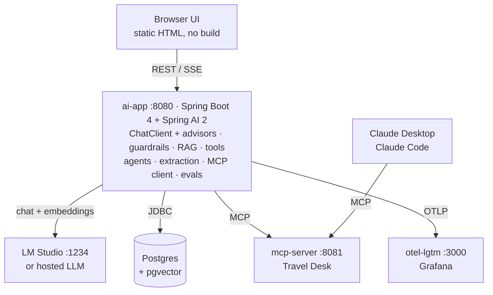

# Acme AI Showcase — enterprise AI patterns with Spring Boot + Spring AI

A runnable sample of the AI patterns enterprises are adopting now. It's built on **Spring Boot 4.1**, **Spring AI 2.0** and **Java 25**.

- **One use case per demo.** Each feature is its own demo with a realistic use case at the fictional *Acme Corp*.
- **Ready to demo.** Every demo has seed data and one-click examples.
- **Local first.** Everything runs locally against **LM Studio**.
- **Config-only provider swap.** Switching to a hosted OpenAI-compatible provider changes configuration only, not code.

| # | Demo | Acme use case | What it shows |
|---|------|---------------|---------------|
| 1 | Chat & memory | Customer-support assistant that remembers the customer | `ChatClient`, `MessageChatMemoryAdvisor`, `JdbcChatMemoryRepository`, SSE token streaming |
| 2 | Guardrails | Public banking chat | PII redaction, prompt-injection blocking, topic and output guards as advisors, `SafeGuardAdvisor`, RFC 9457 errors |
| 3 | RAG with citations | HR & IT policy Q&A over the handbook (MD + PDF) | Tika ETL, `TokenTextSplitter`, pgvector, `RetrievalAugmentationAdvisor`, metadata filters, grounded "not found" answers |
| 4 | Tools + human-in-the-loop | IT helpdesk agent | `@Tool`, Spring AI 2 `ToolCallingAdvisor`, approval gate for sensitive tools, audit log |
| 5 | Agent patterns | Copy pipeline, inbox triage, impact analysis, launch kit, code review | Chain, routing, parallelization (virtual threads), orchestrator-workers, evaluator-optimizer |
| 6 | Structured extraction | Accounts-payable invoices, meeting notes | `entity()` with provider-native JSON schema, Bean Validation (`@TotalsMatch`), retry and human review |
| 7 | MCP server + client | Acme Travel Desk (FX, time zones, holidays) | `@McpTool` / `@McpResource` / `@McpPrompt`, Streamable HTTP, MCP client tool discovery, works with Claude |
| 8 | Observability | AI operations dashboard | Micrometer `gen_ai.*` observations, OpenTelemetry → Grafana LGTM, tokens and latency per feature, traces |
| 9 | LLM evaluation | RAG quality gate in CI | Golden set, `RelevancyEvaluator`, `FactCheckingEvaluator`, JUnit gate (`-Pllm-eval`) |

👉 **[DEMO.md](DEMO.md)** is the click-by-click demo script, with the result to expect for each demo.
📖 **[docs/CONCEPTS.md](docs/CONCEPTS.md)** explains each concept and what happens behind the scenes on a request. The same guide is in the demo UI at http://localhost:8080/concepts.html, and each demo page links to its section.

## Architecture



Postgres and Grafana LGTM are started automatically by Spring Boot's Docker Compose support ([ai-app/compose.yaml](ai-app/compose.yaml)) when ai-app starts.

## Prerequisites

| Requirement | Notes |
|---|---|
| **JDK 25** | Point `JAVA_HOME` at it. Maven is not needed because the Maven wrapper (`mvnw`) downloads it. |
| **Docker Desktop** | Runs Postgres/pgvector and Grafana LGTM, and Testcontainers in the tests. |
| **LM Studio** | Serves the models through its OpenAI-compatible server on `http://localhost:1234/v1`. |

Load a chat model and the embedding model in LM Studio. These were tested on an RTX 3050 with 4 GB of VRAM:

```bash
lms load qwen3-4b --context-length 16384
```

```bash
lms load text-embedding-nomic-embed-text-v1.5
```

Any tool-calling chat model works. Small models are noticeably weaker at multi-step tool use and judging, so expect occasional misses; [DEMO.md](DEMO.md) points them out.

> Qwen3 "hybrid" models think out loud by default. `acme.llm.system-prompt-suffix=/no_think` (the default) switches that off, and `ModelQuirksAdvisor` strips any `<think>` blocks. For the Qwen3-4B-Instruct-2507 build or other models, set `LLM_SYSTEM_PROMPT_SUFFIX=` (empty).

## Run it

1. Start the MCP server in its own terminal (port 8081):

   ```bash
   ./mvnw -pl mcp-server spring-boot:run
   ```

2. Start the main app (port 8080). It also starts Postgres and Grafana in Docker and loads the sample handbook:

   ```bash
   ./mvnw -pl ai-app spring-boot:run
   ```

3. Open **http://localhost:8080** for the demo UI, and **http://localhost:3000/d/acme-ai-overview** for the Grafana dashboard (login admin/admin).

On Windows PowerShell, use `.\mvnw.cmd` instead of `./mvnw`. The ready-made API calls for every demo are in [http/requests.http](http/requests.http), which runs in the IntelliJ or VS Code REST client.

## Switch to a hosted model (no code changes)

All feature code depends only on `ChatClient`, `ChatModel`, `EmbeddingModel` and `VectorStore`. The provider is configuration:

```bash
OPENAI_API_KEY=sk-... OPENAI_CHAT_MODEL=<model-id> ./mvnw -pl ai-app spring-boot:run -Dspring-boot.run.profiles=openai
```

- **[application-openai.yml](ai-app/src/main/resources/application-openai.yml)** sets the base URL, the key, the models, and 1536-dimensional embeddings. It also turns off the local-model quirks.
- **Any OpenAI-compatible endpoint works** (Azure OpenAI, Groq, vLLM, Ollama's `/v1`, …). Set `OPENAI_BASE_URL`, or override `LLM_BASE_URL`, `LLM_API_KEY`, `CHAT_MODEL` and `EMBEDDING_MODEL` with the default profile.
- **Changing the embedding model changes the vector dimensions, so re-index once:** start once with `--spring.ai.vectorstore.pgvector.remove-existing-vector-store-table=true`, then call `POST /api/docs/samples?force=true` (the UI's "Reload sample handbook" button does the same).

## Tests

| Command | What runs | Needs |
|---|---|---|
| `./mvnw verify` | **Unit tests:** guardrails, PII, injection rules, `@TotalsMatch`, model-quirks advisor, the human-in-the-loop flow and agent workflows (with a scripted `StubChatModel`), and the MCP tools. **Integration test:** Flyway seed, ingestion dedupe, category filters, PDF via Tika and JDBC chat memory on real pgvector, using deterministic fake embeddings. | Docker |
| `./mvnw verify -Pllm-eval` | **RAG quality gate** ([RagQualityGateIT](ai-app/src/test/java/com/acme/ai/evaluation/RagQualityGateIT.java)) against the real models. It prints a scorecard and fails below `acme.evaluation.min-pass-rate`. | Docker + LM Studio |
| `./mvnw verify -Pllm-eval -Dacme.rag.top-k=1 -Dacme.rag.similarity-threshold=0.95` | The same gate with starved retrieval, to show it catching a regression. | Docker + LM Studio |

A 4B model is a noisy judge. The gate combines deterministic fact checks with LLM-as-judge, runs the judge at temperature 0, and normalizes its verdicts. Expect roughly 80–90% with qwen3-4b and higher with larger models.

## Project layout

```
pom.xml                         parent: Boot 4.1.1, Spring AI BOM 2.0.1, Java 25, llm-eval profile
mcp-server/                     Acme Travel Desk MCP server (Streamable HTTP, port 8081)
ai-app/
  compose.yaml                  Postgres+pgvector, grafana/otel-lgtm (started by Spring Boot)
  observability/                provisioned Grafana dashboard "Acme AI Overview"
  src/main/java/com/acme/ai/
    config/                     AiClients (per-feature ChatClient), ModelQuirksAdvisor, error handling, status
    chat/                       demo 1   guardrails/  demo 2   rag/          demo 3
    helpdesk/                   demo 4   agents/      demo 5   extraction/   demo 6
    mcp/                        demo 7   observability/ demo 8 evaluation/   demo 9
  src/main/resources/
    application.yml             local LM Studio defaults + acme.* demo knobs
    application-openai.yml      hosted provider profile
    db/migration/               Flyway: chat memory, KB registry, helpdesk schema + seed
    demo/handbook/              fictional Acme handbook (5 Markdown files + 1 PDF)
    eval/rag-golden.json        golden question set for demo 9
    static/                     UI (index.html, app.js, styles.css, samples.json) + concepts.html guide
docs/CONCEPTS.md                concepts and behind-the-scenes walkthrough for every demo
http/requests.http              every demo as an HTTP request
DEMO.md                         demo script with expected results
```

## Tuning knobs (`acme.*` in application.yml)

| Property | Default | Purpose |
|---|---|---|
| `acme.llm.system-prompt-suffix` | `/no_think` | Appended to every system prompt (model quirk) |
| `acme.llm.strip-thinking` | `true` | Remove `<think>` blocks from answers |
| `acme.rag.top-k` / `similarity-threshold` | `4` / `0.55` | Retrieval breadth and strictness |
| `acme.rag.rewrite-query` | `false` | Extra LLM call to rewrite vague questions before searching |
| `acme.guardrails.llm-injection-classifier` | `false` | Add an LLM classifier behind the injection heuristics |
| `acme.guardrails.allowed-topics` / `denylist` | banking topics / … | Topic guard keywords and denylisted terms |
| `acme.extraction.max-retries` | `2` | Validation-feedback retries before flagging for review |
| `acme.agents.evaluator-max-rounds` | `3` | Evaluator-optimizer loop limit |
| `acme.evaluation.min-pass-rate` | `0.8` | RAG quality-gate threshold |

## Use the MCP server from Claude

The Travel Desk server is a normal MCP server, so any MCP client can use it:

```bash
claude mcp add --transport http acme-travel-desk http://localhost:8081/mcp
```

For Claude Desktop, add it through the `mcp-remote` bridge in `claude_desktop_config.json`:

```json
{ "mcpServers": { "acme-travel-desk": { "command": "npx", "args": ["mcp-remote", "http://localhost:8081/mcp"] } } }
```

## Troubleshooting

| Symptom | Fix |
|---|---|
| HTTP 502 "LLM unavailable" | LM Studio's server is not running, or the model in `CHAT_MODEL` isn't loaded (`lms ps`). |
| HTTP 503 in the MCP demo | Start `mcp-server` on port 8081. |
| App fails at startup on Docker | Start Docker Desktop. The Compose services need about 2 GB of images on first run. |
| RAG says "not found" for everything | The handbook isn't ingested yet (the embedding model was down at startup). Click "Reload sample handbook". |
| Slow answers | It's a local 4B model. The parallel and orchestrator demos benefit from LM Studio's parallel slots (`lms ps` shows PARALLEL). |
