# What happens behind each demo

This guide covers every topic in the Acme AI Showcase: the concept, why enterprises care, and the exact path a request takes through the code. Section 0 describes the plumbing that every demo shares, so read it first.

> The same guide, with drawn diagrams, is part of the demo UI: open http://localhost:8080/concepts.html (or **Concepts guide** in the sidebar). Each demo page links to its section.

**Contents:**
0. [The common chassis](#0-the-common-chassis-chatclient-and-advisors)
1. [Chat memory & streaming](#1-chat-with-persistent-memory-and-streaming)
2. [Guardrails](#2-guardrails)
3. [RAG with citations](#3-rag-with-citations)
4. [Tools + human approval](#4-tool-calling-with-human-in-the-loop)
5. [Agent patterns](#5-agentic-workflow-patterns)
6. [Structured extraction](#6-structured-extraction)
7. [MCP](#7-model-context-protocol)
8. [Observability](#8-observability)
9. [LLM evaluation](#9-llm-evaluation-as-a-quality-gate)

---

## 0. The common chassis: ChatClient and advisors

*Shared by all nine demos.*

### The idea

Spring AI gives you provider-neutral building blocks:
- `ChatModel` sends one request to an LLM.
- `EmbeddingModel` turns text into vectors.
- `VectorStore` stores and searches those vectors.

On top sits `ChatClient`, a fluent API that pushes every request through an ordered chain of **advisors**. An advisor works like a servlet filter or AOP around-advice: it sees the request on the way in and the response on the way out, and it can change either, answer on its own without calling the model, or call the rest of the chain several times.

Almost every enterprise concern in this project is an advisor: memory, guardrails, retrieval, tool execution, metrics and model quirks. Feature code stays short because each concern sits in its own layer.

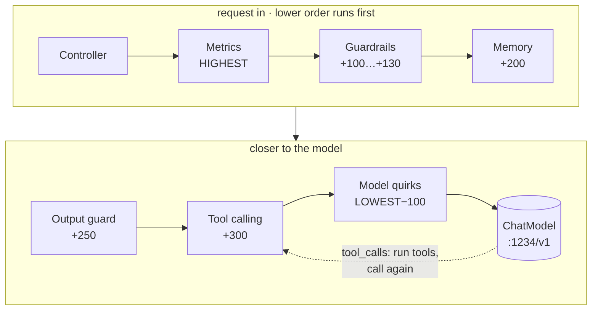

Advisors are ordered by `getOrder()`; lower runs first on the way in, and the response returns through them in reverse. Metrics and model quirks wrap every demo and come from `AiClients.forFeature()`. The others are added per demo: guardrails and the output guard in demo 2, memory in demos 1 and 2, tool calling in demos 4 and 7, and `RetrievalAugmentationAdvisor` (order 0) in demo 3.

### Behind the scenes

1. Each demo asks `AiClients.forFeature("rag")` for its own `ChatClient.Builder`. It comes preloaded with `FeatureMetricsAdvisor` (outermost, for metrics and spans per feature) and `ModelQuirksAdvisor` (innermost, closest to the model).
2. The demo adds its system prompt and its own advisors, such as memory, guardrails or RAG.
3. On `.call()`, ChatClient builds a `Prompt` (system message, history, user message), merges the options (model name, temperature, tool definitions), sorts the advisors and auto-registers Spring AI 2's `ToolCallingAdvisor` at order +300. A final `ChatModelCallAdvisor` at the bottom of the chain makes the actual model call.
4. `OpenAiChatModel` turns the prompt into an OpenAI Chat Completions request and sends it with the official `openai-java` SDK to `{base-url}/chat/completions`. By default the base URL is LM Studio at `http://localhost:1234/v1`.
5. Each advisor can write into a **context map** that travels with the request and is copied onto the response. That's how the UI later shows "what the LLM saw", which chunks were retrieved, and which guard answered.

### Why switching providers is config-only

LM Studio implements the same HTTP protocol as OpenAI. Nothing in the feature code imports a provider class, so moving to a hosted model only changes `base-url`, `api-key` and the model names (the `openai` profile). The same holds for Azure OpenAI, Groq, vLLM, or Ollama's `/v1` endpoint.

`ModelQuirksAdvisor` handles one local-model problem. Qwen3 "hybrid" models reason out loud by default. The advisor appends Qwen's `/no_think` switch to every system prompt and strips any `<think>…</think>` block from the answer, including blocks that arrive across streamed chunks. LM Studio already moves reasoning into a separate `reasoning_content` field, so the stripping is a safety net. The `openai` profile turns both off.

**In the code:** `config/AiClients.java`, `config/ModelQuirksAdvisor.java`, `observability/FeatureMetricsAdvisor.java`, `application.yml`, `application-openai.yml`

---

## 1. Chat with persistent memory and streaming

*Use case: Acme Connect's support assistant remembers the customer, even after the server restarts.*

### The idea

LLM APIs are **stateless**. Every request stands alone, and the model remembers nothing between calls. "Memory" means the application sends the earlier conversation again with each new message. You decide what to send: the last N messages (a window), a running summary, or facts retrieved from a long-term store. Keeping that history in a database means any app instance can serve the next turn, conversations survive restarts and deployments, and app servers stay stateless and easy to scale.

**Streaming** addresses perceived speed. A model produces its answer one token at a time. With `stream: true` the provider sends each token chunk as soon as it exists, so the first words show up in about a second instead of after the whole answer is done.

### What the model actually receives on turn 2

```text
// one request to /v1/chat/completions, assembled by MessageChatMemoryAdvisor
[system]    You are "Ava", the customer-support assistant of Acme Connect … /no_think
[user]      Hi, I'm Priya. I'm on the Pro plan and my router keeps dropping Wi-Fi…   ← from Postgres
[assistant] Hi Priya! I'm sorry to hear about the Wi-Fi issues…                      ← from Postgres
[user]      Remind me: what's my name and which plan am I on?                       ← new message
```

### Behind the scenes

1. The browser POSTs `{conversationId, message}` to `/api/chat/stream`. It uses `fetch` and reads the response body as a stream, because the browser's `EventSource` can only make GET requests.
2. `SupportChatService` passes the conversation id to the advisors as `ChatMemory.CONVERSATION_ID` in the advisor context.
3. `MessageChatMemoryAdvisor` loads the history through `MessageWindowChatMemory` (the last 20 messages) and `JdbcChatMemoryRepository`, which reads the `spring_ai_chat_memory` table ordered by sequence. It puts that history between the system prompt and the new message, and saves the new user message right away.
4. `.stream().content()` calls the model in streaming mode and returns a `Flux<String>` of token chunks.
5. The controller wraps every chunk as a Server-Sent Event: `data:{"t":" Pri"}`. The JSON wrapper keeps leading spaces and line breaks, which plain SSE `data:` lines would drop. A final `event: done` closes the stream, and errors arrive as an `event: error`.
6. When the stream finishes, `ChatClientMessageAggregator` joins the chunks into one assistant message, and the memory advisor saves it. On the next turn the cycle repeats with one more pair of rows.

### Design decisions and lessons

- Flyway creates the memory table (`V1__schema.sql`), not Spring AI's schema initializer, so the schema is versioned with the app (`initialize-schema: never`).
- Docker Compose runs with `lifecycle-management: start-only`, so Postgres keeps running while you restart the app. That's what makes the "restart and it still remembers" demo work.
- The window counts messages, not tokens. A long conversation with big messages can still exceed the 16k context window. Production systems add token-based trimming or summarization.
- Conversation ids are global. The guardrails demo stores its messages under `bank-demo` in the same table, which is how you can inspect what was stored there.

**In the code:** `chat/SupportChatService.java`, `chat/ChatController.java`, `db/migration/V1__schema.sql`, `static/app.js` (`sendChat()`)

---

## 2. Guardrails

*Use case: Acme Bank's public chat must not send customer data to the model provider and must not be hijacked.*

### The idea

An LLM follows instructions from anyone who can type into it, and its output is probabilistic. Guardrails are checks you control that sit around the model. **Input guards** decide what may reach the model; **output guards** decide what may reach the user. In enterprises the drivers are:

- **Data minimization.** GDPR and data processing agreements limit what you may send to a third-party API, and card numbers have no business leaving your network.
- **Prompt injection.** OWASP ranks it as the top LLM risk (LLM01): a user tries to override your instructions.
- **Scope.** A bank assistant writing poems costs tokens and creates brand risk.
- **Leakage.** System prompts often contain business rules you don't want published.

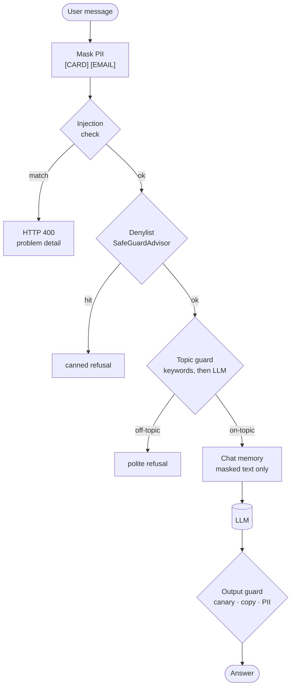

Input guards run before the memory advisor, so a blocked or refused request leaves no trace in the model provider's logs or in the database. The output guard sits inside the memory advisor (+250 versus +200), so memory stores the filtered answer, not the raw one.

### Behind the scenes

1. **PII redaction (+100).** Regex detectors run in a fixed order: email, IBAN, card, SSN, phone. A card number must be 13–19 digits *and* pass the Luhn checksum, so order numbers survive. A phone number must have 8–15 digits. Matches become placeholders through `prompt.augmentUserMessage()`. The masked text and the counts per type go into the context map and become the UI's "What the LLM saw" panel.
2. **Injection check (+110).** Five pattern families: override instructions, reveal the system prompt, role hijack ("you are now DAN"), jailbreak keywords, and fake system tags. A match throws `GuardrailViolationException`. `ApiExceptionHandler` turns it into an RFC 9457 problem detail with `guard` and `rule` fields and status 400. An optional LLM classifier can run as a second line (`acme.guardrails.llm-injection-classifier`).
3. **Denylist (+120).** Spring AI's built-in `SafeGuardAdvisor` answers with its fixed refusal when the input contains a denylisted term.
4. **Topic guard (+130).** A keyword match on the allowed banking topics passes immediately. Otherwise a separate, short LLM call classifies the message as ON_TOPIC or OFF_TOPIC. An off-topic message gets a canned reply built as a `ChatClientResponse` without calling the chain, so the main model and the memory are never involved.
5. **Output guard (+250).** After the model answers, it withholds the reply if it contains the **canary token** planted in the system prompt (`ACME-CANARY-7Q2X`) or 12+ consecutive words copied from the prompt. It also withholds denylisted terms and masks PII the model produced.
6. Every intervention increments `acme.guardrails.events{guard, action}`, which feeds the Grafana dashboard.

### Design decisions and lessons

- The first leak detector matched any 6-word overlap with the system prompt and blocked a normal answer ("use the Acme Bank app or a branch"). A canary token plus a 12-word window is the standard way to catch real prompt dumps without false alarms.
- Output masking also hid the bank's own support phone number. The fix was to keep phone numbers out of the system prompt. Guards have to agree with the prompt they protect.
- Regex PII detection doesn't understand language like named-entity recognition does, and heuristic injection rules can be bypassed with paraphrases, other languages or encodings. Real deployments layer a classifier model or a DLP service on top.
- Not covered here: **indirect** injection, where instructions hide inside retrieved documents or tool results (see demos 3, 4 and 7). That needs separate handling of untrusted content.

**In the code:** `guardrails/GuardrailAdvisors.java`, `guardrails/PiiRedactor.java`, `guardrails/PromptInjectionDetector.java`, `guardrails/BankingAssistantService.java`, `config/ApiExceptionHandler.java`

---

## 3. RAG with citations

*Use case: employees ask HR, IT and finance policy questions and get answers from the Acme handbook, with sources.*

### The idea

The model knows nothing about Acme's handbook, and fine-tuning is expensive and goes stale whenever a policy changes. **Retrieval-augmented generation** finds the relevant passages at question time and puts them into the prompt. Answers stay current, sources can be checked, and "I don't know" is possible.

Retrieval relies on **embeddings**. An embedding model maps a piece of text to a vector (here 768 numbers) so that texts with similar meaning land close together, measured by cosine similarity. "How fast must I report a lost laptop?" lands near the paragraph about lost devices even though they share few words. A vector database indexes these vectors for fast nearest-neighbour search.

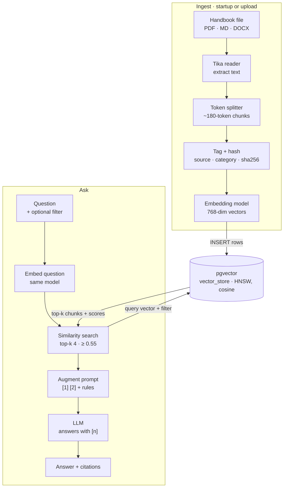

Both paths must use the same embedding model; otherwise the question's vector and the stored vectors live in different spaces. Before ingesting, a file's sha256 is compared with the `kb_document` registry: an unchanged file is skipped, and a changed file has its old chunks deleted first.

### Behind the scenes: ingest

1. `HandbookLoader` runs on a virtual thread after startup, so the app starts even when the embedding model is down. Uploads and the "Reload sample handbook" button go through the same `IngestionService`.
2. `TikaDocumentReader` detects the format and extracts plain text, using PDFBox for the PDF.
3. `TokenTextSplitter` cuts the text into ~180-token chunks at sentence boundaries, giving 2–3 chunks per handbook file.
4. Each chunk gets `source`, `category` and `sha256` metadata, so search can filter on it and re-ingestion can find and delete it.
5. `PgVectorStore.add()` calls the embedding model (LM Studio `/v1/embeddings`, nomic-embed-text) and inserts each row (id, content, JSONB metadata, `vector(768)`) into `vector_store`, which has an HNSW index for approximate nearest-neighbour search.

### Behind the scenes: ask

1. `RetrievalAugmentationAdvisor` takes the user's question. An optional `RewriteQueryTransformer` can rephrase vague questions first; it's off by default because it costs an extra LLM call.
2. `VectorStoreDocumentRetriever` embeds the question and searches for the top 4 chunks with similarity ≥ 0.55. If the UI sets a category, the request carries the filter `category == 'IT'`, which Spring AI translates from its portable filter language into a JSONB predicate in SQL. The category comes from an enum, so user text never reaches the filter.
3. `ContextualQueryAugmenter` formats the chunks as numbered sources (`[1] (it-security-policy.md) …`) into a template with rules: cite like [1], use only these sources, and reply with an exact "not found" sentence otherwise. If *no* chunk passed the threshold, a different template makes the model say "I couldn't find that in the Acme handbook documents."
4. The retrieved chunks travel back in the response context (`DOCUMENT_CONTEXT`). The service turns them into citations with their similarity scores and marks a source **cited** when the answer contains its [n].

### Design decisions and lessons

- Chunk size is a trade-off. Big chunks dilute similarity and answers miss details; small chunks lose surrounding context. With 350-token chunks the lost-laptop question retrieved a chunk without the "within 1 hour" rule; at 180 tokens the answer included it.
- The vector dimension (768) is fixed when the table is created. A different embedding model means re-creating the table and re-ingesting, which the `force=true` option supports.
- Small models sometimes answer correctly but cite the wrong [n]. Demo 9 measures this.
- nomic-embed-text retrieves better with task prefixes (`search_query:` / `search_document:`). They're left out to keep the code provider-neutral.

**In the code:** `rag/IngestionService.java`, `rag/PolicyQaService.java`, `rag/HandbookLoader.java`, `demo/handbook/*`

---

## 4. Tool calling with human-in-the-loop

*Use case: an IT helpdesk agent looks up employees and laptops and opens tickets by itself, but a person must approve password resets and hardware loans.*

### The idea

With **tool calling** (also called function calling), you send the model a list of tools, each with a name, a description and a JSON schema for its parameters. Instead of text, the model can reply with `tool_calls`: "call `lookupEmployee` with `{"username":"jdoe"}`". Your application runs the function and sends the result back as a tool message, and the model continues until it can give a final answer. **The model never executes anything; your code does.** That's the control point.

An **agent** is this loop running freely: the model decides which tools to use and in what order. The more side effects the tools have, the more you need controls: least-privilege tools, an audit log, and human approval for actions you can't undo.

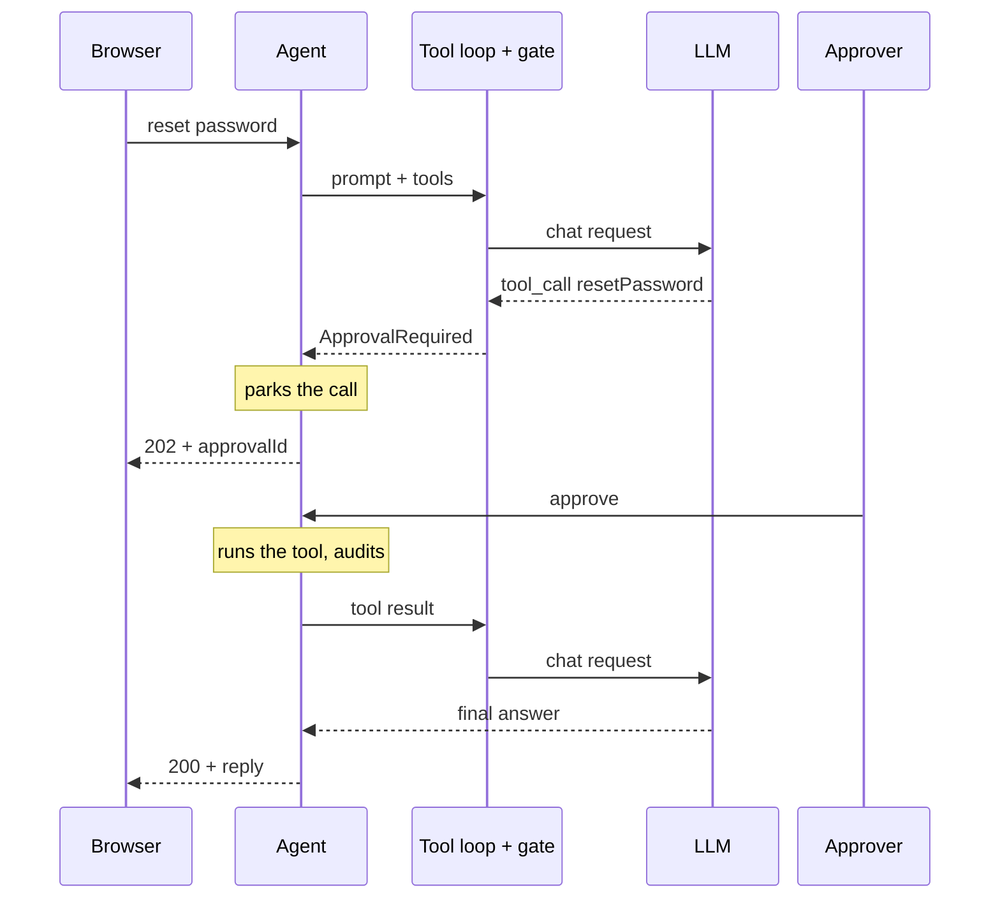

The pause is an exception that carries the whole conversation. Nothing changes in the database until the human decides, and the approved call is executed by the application, not re-requested from the model.

### Behind the scenes

1. `HelpdeskTools` methods carry `@Tool(description = …)` and `@ToolParam`. Spring AI reads them by reflection and builds a JSON schema for each tool; `.tools(helpdeskTools)` attaches them to the request. The descriptions are written for the model, because they're how it decides which tool to use.
2. In Spring AI 2 the tool loop lives in `ToolCallingAdvisor`. It calls the model; if the reply contains tool calls, it hands them to a `ToolCallingManager`, appends the assistant's tool-call message and a `ToolResponseMessage` to the history, and calls the model again.
3. The agent registers its own `ToolCallingAdvisor` built with `ApprovalGatingToolCallingManager`, a decorator around the real manager. Safe tools (`lookupEmployee`, `listAssets`, `createTicket`) run immediately, and each call is recorded in a `ToolTrace` for the UI.
4. If the model asks for a method annotated `@RequiresApproval` (`resetPassword`, `assignLoanerLaptop`), the gate throws `ApprovalRequiredException` holding the full `Prompt` and the model's tool-call message. `HelpdeskAgent` catches it, stores it in `PendingApprovalStore` under a UUID, and the controller answers **202 Accepted**.
5. **Approve:** the parked tool calls run through the real manager, so the reset happens now. The conversation, including the tool result, is sent through ChatClient again, and the model writes the final reply. **Reject:** the agent creates a tool result that says "REJECTED by a human approver … do not retry", so the model explains that the action wasn't done.
6. Every action and decision goes to the `audit_log` table and the `acme.approvals` counters. When a tool fails (an unknown username, say), Spring AI returns the error text to the model instead of failing the request, so the model can correct itself.

### Design decisions and lessons

- The gate works at the tool-execution boundary, so it applies no matter how the model phrases its plan. Nothing relies on the model choosing to ask for permission.
- Small models take shortcuts, such as resetting a password without looking up the employee first. The tool trace makes that visible, and in production you would enforce such rules inside the tool itself.
- The pending store lives in memory, so approvals are lost on restart (a demo shortcut). A real system would save the conversation as JSON in a table and notify approvers.
- If one model reply mixes safe and sensitive calls, the whole batch waits for approval.

**In the code:** `helpdesk/HelpdeskTools.java`, `helpdesk/ApprovalGatingToolCallingManager.java`, `helpdesk/HelpdeskAgent.java`, `helpdesk/PendingApprovalStore.java`, `db/migration/V2__helpdesk_seed.sql`

---

## 5. Agentic workflow patterns

*Five patterns from Anthropic's "Building effective agents", each on an Acme use case.*

### The idea

Anthropic separates **workflows**, where your code decides the sequence of LLM calls, from **agents**, where the model decides its own steps and tools (demo 4). Most production value comes from simple, composable workflows: they're predictable, testable and cheaper. Each pattern trades extra latency or cost for better quality or capability. All five here are plain `ChatClient` calls in ordinary Java, with no agent framework.

### Chain: 4 sequential calls

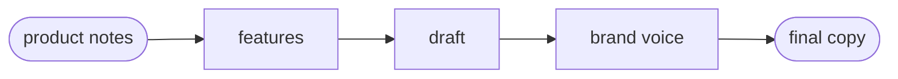

Marketing copy from raw product notes. Each prompt does one small job, which is easier for a small model to get right than one big prompt. You can add code checks ("gates") between steps.

### Routing: 1 classify call + 1 specialist call

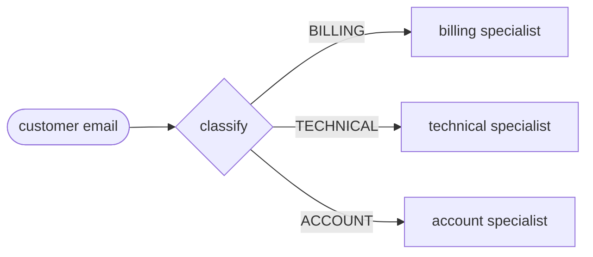

Support-inbox triage. The classifier returns `RouteDecision(reason, route)` as structured output, then a prompt written for that category replies. Each specialist prompt can be tuned on its own, and easy categories can go to a cheaper model.

### Parallelization: 4 concurrent calls

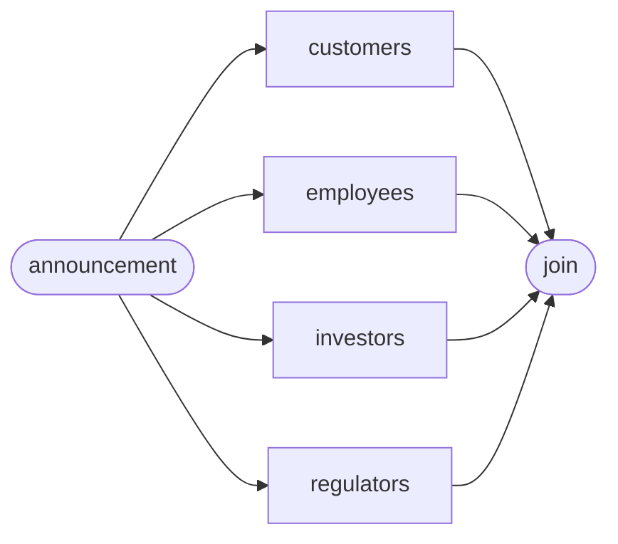

Impact of a price increase on four stakeholder groups. The calls run on **virtual threads**, and LM Studio serves four requests at once, so the wall time is about the slowest call (9.5 s) instead of the sum (36 s). A variant called "voting" sends the same prompt N times and combines the answers.

### Orchestrator-workers: 1 plan call + 2–4 worker calls

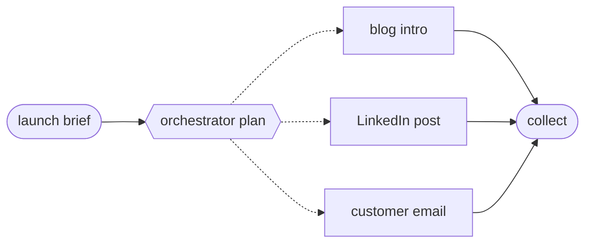

A launch content kit. Unlike parallelization, the subtasks aren't known in advance: the orchestrator returns `Plan(analysis, tasks[])` as structured output, and a worker call is made for each task. The dashed edges are decided at runtime.

### Evaluator-optimizer: 2 calls per round, max 3 rounds

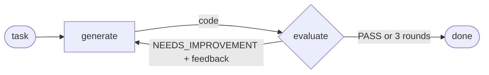

Java code with an automated reviewer. This pattern works when the evaluation criteria are clear. The round cap is essential: a strict 4B reviewer often never says PASS, and without a cap the loop would never end.

### Behind the scenes

- **Structured decisions.** Routing, orchestration and evaluation return Java records through `.entity(…, spec -> spec.useProviderStructuredOutput())`, so the decision is typed data, not text to parse (see demo 6).
- **Field order and wording matter.** With native structured output the model sees the field *names* but not their descriptions. At first `reason` came back as just "BILLING". Describing each field in the system prompt, and putting `reason` and `feedback` *before* the verdict so the model explains first, fixed it.
- **Tracing across threads.** Parallel calls run on `Executors.newVirtualThreadPerTaskExecutor()` wrapped in Micrometer's `ContextExecutorService`, so each model call stays a child span of the HTTP request in Grafana.
- **Visible steps.** Every workflow returns its intermediate steps with timings (`AgentStep`), so the UI shows the pattern working instead of just the end result.

**In the code:** `agents/ChainWorkflow.java`, `agents/RoutingWorkflow.java`, `agents/ParallelizationWorkflow.java`, `agents/OrchestratorWorkersWorkflow.java`, `agents/EvaluatorOptimizerWorkflow.java`, `agents/TracedExecutors.java`

---

## 6. Structured extraction

*Use cases: accounts-payable invoice processing, and meeting notes turned into action items.*

### The idea

Back-office automation needs typed data that a system can act on, not prose. There are three levels of getting JSON from an LLM:

- **Asking in the prompt.** Fragile: the model may add chatter or markdown fences.
- **JSON mode.** Guarantees valid JSON, but not its shape.
- **Schema-constrained decoding** ("structured outputs"). The inference engine only allows tokens that keep the output valid against your JSON schema.

Even a perfect schema can say "`total` is a number" but not "total = subtotal + tax", so **validation** stays in your code. Clean documents flow straight through, and exceptions go to a person.

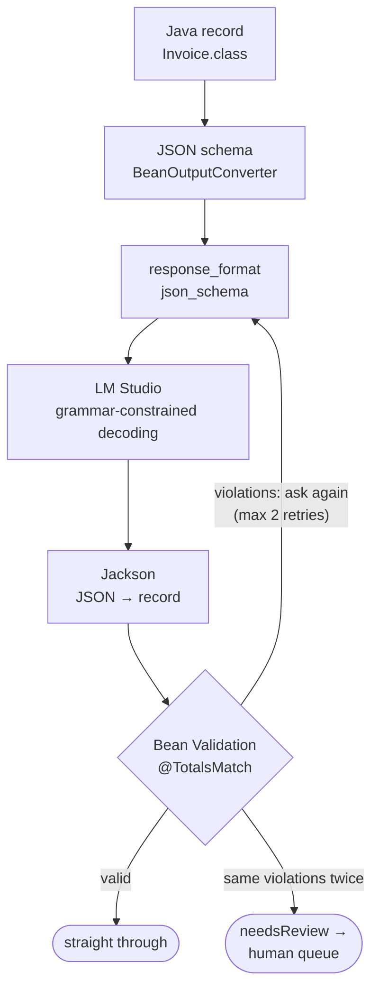

Shape is guaranteed by the decoder; meaning is checked in Java. When a retry returns exactly the same violations, the model has re-read the document and confirmed its values, so the document itself is wrong and it goes to a person.

### Behind the scenes

1. `.entity(Invoice.class, spec -> spec.useProviderStructuredOutput())` makes Spring AI's `BeanOutputConverter` generate a JSON schema from the record: field types, required fields, and `@JsonPropertyDescription` texts.
2. Because of `useProviderStructuredOutput()`, the schema goes into the request as `response_format: {type: "json_schema"}` instead of as instructions inside the prompt text.
3. LM Studio (llama.cpp underneath) compiles the schema into a grammar and, at every step, masks out tokens that would break it. The reply is always parseable JSON with the right shape, with no markdown fences and no chatter. OpenAI's structured outputs work the same way, so this also carries over to hosted models.
4. Jackson maps the JSON into the record, including `BigDecimal` amounts and `LocalDate` dates.
5. Jakarta Bean Validation runs field rules (`@NotBlank`, a currency `@Pattern("[A-Z]{3}")`, `@Positive`, nested `List<@Valid LineItem>`) and the class-level `@TotalsMatch` constraint: line items must add up to the subtotal and subtotal + tax to the total, within one cent.
6. Violations go back to the model as a re-check request. Identical violations twice means the source is inconsistent: the result is returned with `needsReview=true` and the exact rule that failed, for example `subtotal 1279.0 + tax 0.0 = 1279.0 but total is 1379.0`.

### Design decisions and lessons

- LLMs are unreliable at arithmetic. The model is told to copy values exactly as printed, and the validator does the math. Letting the model "fix" totals would hide real billing errors.
- Stopping early on repeated violations cut the inconsistent-invoice case from three attempts (about 60 s) to two.
- Instructions that matter belong in the system prompt, because in native mode the model doesn't see the schema's descriptions. That's how German formats (`1.504,80`, `02.10.2026`) get normalized correctly.
- Relative dates ("next Wednesday") are hard for a 4B model even with explicit rules. A production version would resolve them in code from the meeting date.

**In the code:** `extraction/ExtractionService.java`, `extraction/Invoice.java`, `extraction/TotalsMatch.java`, `extraction/MeetingNotes.java`

---

## 7. Model Context Protocol

*Use case: Acme Travel Desk, an internal tool server that any AI client can use.*

### The idea

**MCP** is an open protocol, introduced by Anthropic in November 2024 and now supported across the industry, that standardizes how AI applications connect to tools and data. You build a tool server once, and Claude Desktop, Claude Code, IDE assistants and your own Spring app can all use it. That turns N×M custom integrations into N+M.

- **Tools** are actions the *model* chooses to call.
- **Resources** are data the *application* reads and attaches as context.
- **Prompts** are reusable templates a *user* picks.
- Messages are **JSON-RPC 2.0**, carried over **stdio** (a local subprocess) or **Streamable HTTP** (one endpoint; the client POSTs JSON-RPC and the server answers with JSON or an event stream).

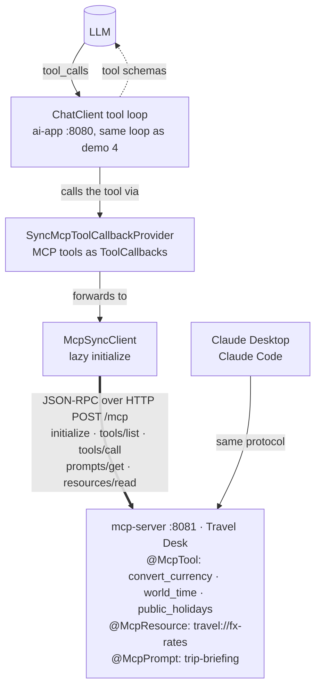

The model never talks to the MCP server directly. It sees MCP tools as ordinary tool schemas, and when it calls one, the app's callback forwards the call as `tools/call` to the server process.

### Behind the scenes: server

1. At startup Spring AI's annotation scanner finds the `@McpTool`, `@McpResource` and `@McpPrompt` methods on `TravelDeskTools` and registers them (the log says "Registered tools: 3, resources: 1, prompts: 1"). Tool input schemas come from the method parameters and `@McpToolParam`.
2. `spring-ai-starter-mcp-server-webmvc` exposes the Streamable HTTP endpoint at `/mcp`. Tools also declare hints such as `readOnlyHint`, which clients can use to decide what needs confirmation.

### Behind the scenes: client

1. `spring-ai-starter-mcp-client` creates an `McpSyncClient` for the `travel-desk` connection in `application.yml`. With `initialized: false` the `initialize` handshake (protocol version and capabilities) waits until first use, so ai-app starts even when the server is down.
2. On a question, `SyncMcpToolCallbackProvider` calls `tools/list` and wraps each MCP tool as a Spring AI `ToolCallback`. The list is cached and refreshed when the server announces that its tools changed.
3. The callbacks join the normal tool loop from demo 4. When the model calls `convert_currency`, the callback sends `tools/call` over HTTP, and the server's JSON result goes back to the model as the tool result. `TracingToolCallback` records each call for the UI as mode `mcp`.
4. The trip briefing calls `prompts/get` with `{city, date, budget}`. The server renders its template, and the app runs the text with the tools. The FX panel calls `resources/read travel://fx-rates`.
5. If the server is unreachable, the failure becomes a 503 problem detail with a hint to start `mcp-server`. The rest of the app keeps working.

### Design decisions and lessons

- An MCP server is a trust boundary. Tool descriptions and tool results come from another system and can carry injected instructions ("tool poisoning"). Treat them as untrusted input.
- Remote MCP servers need authentication; the spec defines OAuth 2.1 for HTTP transports. The demo server has none and should only run locally.
- For a model, MCP tools and local `@Tool` methods look the same. The difference is ownership and reuse: the travel team can update its server without redeploying ai-app.

**In the code:** `mcp-server/…/TravelDeskTools.java`, `mcp-server/…/application.yml`, `ai-app/…/mcp/TravelAssistantService.java`, `support/TracingToolCallback.java`

---

## 8. Observability

*Use case: AI operations. What does each feature cost in tokens, how slow is it, which tools run, and what do the guardrails block?*

### The idea

LLM features fail differently from normal code: calls take seconds, every request costs tokens, the same input can produce different output, and one user request can fan out into many model, tool and database calls. You need cost and latency per feature, block and error rates, and **traces** that show each step of a single request. OpenTelemetry is the vendor-neutral standard for this, and its GenAI semantic conventions define the `gen_ai.*` attributes: model, operation, input and output tokens. Prompts and completions contain personal data, so recording them stays off unless you need to debug.

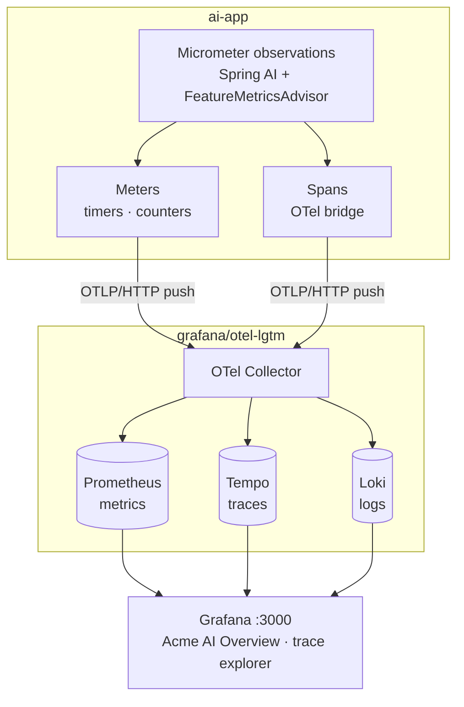

Spring Boot's Docker Compose support sees the `grafana/otel-lgtm` image in `compose.yaml` and fills in the OTLP endpoints itself, so no telemetry URL appears in the configuration.

### Behind the scenes

1. Micrometer's **Observation API** is one instrumentation point that produces both a timer metric and a trace span. Spring AI observes the whole ChatClient call (`spring.ai.chat.client`), each advisor (`spring.ai.advisor`), each model or embedding call (`gen_ai.client.operation` plus the `gen_ai.client.token.usage` counter), each tool execution (`spring.ai.tool`) and each vector-store query (`db.vector.client.operation`).
2. `FeatureMetricsAdvisor` adds the business view: an `acme.ai.feature` observation tagged with `feature` and `outcome` (success, blocked, approval_pending, error), plus `acme.ai.tokens{feature, type}` counters filled from the response's `Usage`. Exceptions that implement `ExpectedOutcome` (a guardrail block, an approval pause) count as outcomes, not errors.
3. `spring-boot-starter-opentelemetry` bridges observations into OpenTelemetry spans and pushes metrics every 10 s, both over OTLP/HTTP.
4. Inside `grafana/otel-lgtm`, one container runs an OTel Collector, Prometheus (metrics), Tempo (traces), Loki (logs) and Grafana. The "Acme AI Overview" dashboard is mounted through `compose.yaml` and loaded automatically.

### A helpdesk request as a trace (simplified)

```text
http post /api/helpdesk/chat                                   4.2 s
└─ chat client                                    spring.ai.chat.client
   └─ acme helpdesk                feature=helpdesk outcome=success
      └─ tool calling advisor
         ├─ chat qwen3-4b        → tool_calls: lookupEmployee     gen_ai.* tokens
         ├─ execute_tool lookupEmployee
         ├─ chat qwen3-4b        → tool_calls: listAssets
         ├─ execute_tool listAssets
         ├─ chat qwen3-4b        → tool_calls: createTicket
         ├─ execute_tool createTicket
         └─ chat qwen3-4b        → final answer
```

### Design decisions and lessons

- Prometheus' `increase()` can't see a counter's first value, so features used once per app run showed 0 tokens. All app counters are now registered at 0 when the app starts.
- p95 latency needs histogram buckets, which Micrometer only publishes when asked (`management.metrics.distribution.percentiles-histogram`).
- The UI polls the approvals list every 10 s. Those GETs flooded the trace list, so the dashboard shows POST requests only, and every AI call is a POST.
- A sampling probability of 1.0 is right for a demo. Production systems sample, and keep prompt and completion logging off for PII.

**In the code:** `observability/FeatureMetricsAdvisor.java`, `observability/ExpectedOutcome.java`, `ai-app/compose.yaml`, `observability/dashboards/acme-ai-overview.json`, `application.yml` (`management.*`)

---

## 9. LLM evaluation as a quality gate

*Use case: catch answer-quality regressions in CI before they ship.*

### The idea

You can't `assertEquals` an LLM answer, yet every change to a prompt, model, chunk size or threshold can quietly make answers worse. **Evals** are the answer:

- A **golden dataset** of inputs with known-good expectations.
- **Deterministic checks** wherever possible: does the answer contain the fact, is it valid JSON, does it refuse correctly?
- **LLM-as-judge** for fuzzy properties such as relevance and groundedness (also called faithfulness).

The result is a pass rate compared with a threshold, not a demand for 100%. Judges are models too, so make them deterministic, constrain what they may answer, and check their verdicts against cases where you know the truth.

### How each golden case is graded

| Check | How | Counts toward pass |
|---|---|---|
| Expected facts | Deterministic: the answer must contain one alternative from each group, for example `["5", "five"]`. | yes |
| Relevant | `RelevancyEvaluator` with a custom prompt: does the response answer the query and agree with the retrieved context? YES / NO. | yes |
| Grounded | `FactCheckingEvaluator`: is the claim supported by the retrieved chunks? Paraphrases count. | yes |
| Refusal case | "What is the CEO's salary?" must produce the exact not-found sentence. | yes (that case only) |
| Cited the right source | Deterministic: does a chunk the answer cites as [n] contain the fact? | no, informational |

### Behind the scenes

1. `eval/rag-golden.json` holds 10 answerable questions with the facts they must mention, plus one question that must be refused.
2. Each case runs through the *real* RAG pipeline (`PolicyQaService.ask` with explicit top-k and threshold) and keeps the retrieved chunks as evidence.
3. The judge ChatClient runs at temperature 0 and carries `VerdictNormalizerAdvisor`. Spring AI's evaluators accept only an exact "yes", so the advisor turns replies like "Yes. The response…" into "yes".
4. The answer is cleaned of `[n]` markers and markdown before judging. A case that hits a transient model-server error is retried once and otherwise counts as failed instead of aborting the whole run.
5. The gate passes when the pass rate is at least `acme.evaluation.min-pass-rate` (0.8).
6. In CI, `RagQualityGateIT` is tagged `llm-eval`. The `-Pllm-eval` Maven profile switches Surefire and Failsafe to that tag, and Testcontainers provides a fresh pgvector database. Maven `-D` properties reach the test JVM, which is how the regression demo starves retrieval.

### Real runs from building this project

| Run | Settings | Passed | Gate |
|---|---|---|---|
| First judge version, graded against cited chunks only | top-k 4, ≥ 0.55 | 8 / 11 | failed |
| Judge graded against all retrieved chunks, temperature 0 | top-k 4, ≥ 0.55 | 9 / 11 · 10 / 11 | passed |
| Plus a paraphrase rule and a custom relevancy prompt (`-Pllm-eval`) | top-k 4, ≥ 0.55 | 11 / 11 | passed |
| Regression demo: starved retrieval | top-k 1, ≥ 0.95 | 1 / 11 | failed the build |

> All 11 answers contained the right facts in every run. The early failures came from the judge. The 4B model often cited the wrong `[n]`, so the evaluator graded the answer against the wrong chunk, and it rejected correct paraphrases ("minimum 14" against "at least 14"). Validating the judge is part of building an eval.

**In the code:** `evaluation/RagEvaluationService.java`, `evaluation/VerdictNormalizerAdvisor.java`, `eval/rag-golden.json`, `test/…/RagQualityGateIT.java`, `pom.xml` (`llm-eval` profile)
